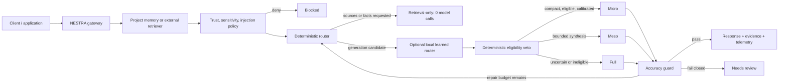

# Architecture

NESTRA is an adaptive inference layer, not an agent, model, or vector database. It owns the decision boundary between a client, retrieval, memory, local ML, and generation.

## Production components

1. `ProjectMemoryIndex` compiles stable documents into deterministic facts, entities, co-occurrence relations, provenance, trust, and sensitivity metadata.
2. A Retriever adapter may replace local retrieval. External documents are untrusted unless the adapter explicitly validates their source.
3. The deterministic Router evaluates authorization, structural chain, document diversity, query and intent coverage, evidence size, and explicit retrieval intent.
4. An optional learned router estimates Micro safety from 15 numeric metadata features. It may change only generation-tier selection. A deterministic eligibility veto remains authoritative.
5. The Runtime executes the selected route and permits at most the configured number of calls.
6. Micro uses a compact two-atom prompt and a deterministic grounding lock.
7. Meso and Full use a strict JSON schema containing answer, confidence, and evidence IDs.
8. The Guard verifies citations, confidence, multi-document support, and output constraints. Full failures return `needs_review` by default.
9. The Store persists versioned snapshots with same-directory temporary files and atomic rename.
10. Hooks, audit records, and metrics expose operational behavior without storing request or evidence content.

## Colony roles

The biological roles describe ownership, not a requirement to run six chatty agents:

- Queen: goal, route, budgets, stopping conditions.
- Scout: maps the minimum information need.
- Forager: retrieves and ranks evidence.
- Builder: produces a candidate answer.
- Guard: enforces evidence and output contracts.
- Caretaker: manages reinforcement, cooling, archival, and deletion.

In the optimized runtime most roles are deterministic local functions. A model is used only by a Builder route, and verification remains local whenever possible.

## Boundaries

Production modules never import benchmark code or Agent Hive. Benchmarks import the public core so the evaluated algorithm and shipped algorithm are the same implementation. Provider, retriever, and storage contracts are intentionally small to keep the gateway portable.

The learned router is not another LLM agent and requires no online training. Training is an offline build step; inference is a local dot product plus sigmoid. See [learned router](learned-router.md).
